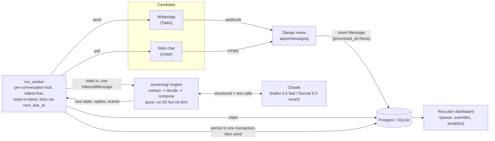

# Grupo Sazón Screening Agent

An AI agent that screens delivery-driver applicants for Grupo Sazón (fictional: 45 locations
in Spain and Mexico, ~1,000 applications/week) over WhatsApp and a web chat, so recruiters work
from a queue of pre-screened candidates instead of cold-calling everyone who applies. Built as
the take-home for Orbio's Forward Deployed Engineer role.

The full product spec lives in [`docs/process-design.md`](docs/process-design.md). This file is
about running and understanding the code.

## Status (2026-10-14)

**CP1 (day 1 target) is done and verified:** the engine completes a full screening against the
real LLM, the web chat creates conversations through the worker, and the admin shows them. See
`docs/coordination/BOARD.md` for the live task board.

| Lane | State |
| --- | --- |
| **Engine** (`screening/`) | Done — E1 through E9 and E6b, the whole conversation engine, extensively tested (200+ tests) and probed against the real API. |
| **App** (Django) | CP1 done — project, worker, web chat. WhatsApp (A4), the recruiter dashboard (A5), analytics (A6), seed data (A7), Docker (A8) are next. |
| **Evals** (`evals/`) | 20 scenarios with ground truth written (V1). The simulator, scorers, model-comparison report and smoke suite (V2–V6) are next. |

**One known gap:** the web chat worker is still wired to a stub engine
(`apps/messaging/services.py`), not the real one in `screening/`, even though the real engine has
been ready for a day. The CLI already talks to the real engine — see below for the difference.

## Architecture

Functional core, imperative shell: `screening/` is pure Python (state in, state + messages +
events out, no I/O except through an injected LLM client) and Django is the shell around it —
persistence, the two channels, the worker, and the recruiter dashboard. The same engine serves
the CLI and the evals runner.



Two rules shape everything else:

- **Code owns the process, the LLM owns the language.** State transitions, validation, knockouts
  and outcomes are deterministic code (`screening/policy.py`, `screening/validators/`). The LLM
  only extracts structured values from messy text and writes replies from a plan — it never
  decides eligibility. That makes every rejection auditable and immune to prompt injection.
- **One lock, one transaction per conversation turn.** The worker claims a conversation with
  `select_for_update(skip_locked=True)`, runs the engine, and persists state + outbound messages +
  events in one transaction before sending anything. That's the entire ordering and
  reply-to-latest guarantee — no separate queue.

See `docs/coordination/DECISIONS.md` for the full, append-only decision log this summarizes.

## Setup

```bash
uv sync
cp .env.example .env            # then add a real ANTHROPIC_API_KEY
uv run python manage.py migrate
uv run python manage.py createsuperuser   # for /admin/; optional
uv run python manage.py runserver 8000    # in a second terminal: run_worker, below
```

`DEBUG=True` from `.env.example` is enough to run locally — SQLite, an auto-generated dev secret
key, no Twilio needed for the web chat.

## Running it

**CLI — talks to the real engine directly, the quickest way to see Alex actually work:**

```bash
uv run python -m screening.cli --country MX --lang es                      # interactive
uv run python -m screening.cli --country MX --script path/to/script.txt    # scripted
uv run python -m screening.cli --fake                                      # no API key, keyword stub
```

Prints every reply, the state diff and the events (including `llm_call` with tokens, cache hits
and latency) after each turn.

**Web chat — exercises the full Django path (worker, persistence, polling):**

```bash
uv run python manage.py runserver 8000
uv run python manage.py run_worker          # second terminal; --once to drain and exit
```

Open `http://localhost:8000/chat/`, pick a country and language. Watch it land in
`http://localhost:8000/admin/`. **Currently runs the stub engine, not the real one** (see
Status) — the conversation mechanics are real, Alex's replies aren't yet.

**WhatsApp:** not wired yet (A4). The contract (`docs/coordination/CONTRACTS.md` §5) specifies a
Twilio webhook at `/webhooks/twilio/whatsapp/` with signature validation and idempotency on
`MessageSid`.

**Recruiter dashboard:** not built yet (A5). Today, `/admin/` shows conversations, messages and
events with inlines.

**Tests:**

```bash
uv run pytest tests/engine tests/evals          # no Django at all, by design
DJANGO_SETTINGS_MODULE=config.settings uv run pytest tests/app
uv run ruff check .
```

**Evals:** the 20 ground-truth scenarios are in `evals/scenarios/*.yaml`, validated by
`evals/scenario.py`. The simulator and scorers that run them against the engine (V2/V3) aren't
built yet — until then, the CLI against a scenario's script is the closest thing to a live run.

## LLM choice and trade-offs

Claude behind a thin typed client (`screening/llm/`) — no LangChain/LangGraph/CrewAI, the
orchestration is a few hundred lines in `screening/engine.py` and `policy.py` that fit in a live
code review. Two tiers: **Haiku 5.5** (fast) for extraction and reply composition, **Sonnet 5.5**
(smart) for the recruiter-facing summary (D12).

What's measured so far, from live probes against the real API (see `status/engine.md` for the
raw numbers):

- Structured output via `messages.parse`, one retry on an invalid record.
- The system prompt (persona, rules, FAQ catalogue, few-shot examples) is cached and
  byte-stable; a live extract call reads ~5,000 of ~5,200 input tokens from cache, at roughly
  1.3 s per call.
- A deterministic guard (`screening/guard.py`) checks every composed reply against the message
  rules (≤300 chars, one question, ≤1 emoji...) and regenerates once, then trims, if it's broken.
  Measured: 4 of 18 first drafts broke a rule; 0 of 18 final replies did (D21).

**Not done yet:** a head-to-head model comparison (V4 — e.g. Haiku vs. Sonnet for
extract/compose on accuracy, latency and cost) is still on the evals board. This section gets
updated with that report and a final recommendation once it lands; today's choice is the
reasonable default, not yet the evals-backed one.

## Key engineering decisions

The full append-only log is `docs/coordination/DECISIONS.md` (23 entries and counting). The ones
most worth knowing:

- **Django over FastAPI, functional core / imperative shell** (D1, D2) — the engine is
  framework-free and unit-testable without a database; Django gives auth, admin and migrations
  for the shell, for free, in a 3-day build.
- **Code decides, the LLM speaks** (D3) — deterministic outcomes, auditable under GDPR Art. 22
  and the EU AI Act, immune to prompt injection by construction.
- **Sequential per-conversation processing, reply only to the latest message** (D7) — a burst of
  messages never produces a stale question.
- **A DB-backed queue and a worker command, no Celery/Redis** (D8) — fewer moving parts at
  1,000/week; `select_for_update(skip_locked)` is enough. Revisit at 10K/week (see below).
- **SQLite tuned for the worker's long transaction** (D16) — `IMMEDIATE` + WAL, so a web insert
  waits instead of failing when the worker is mid-turn. Postgres in deploy needs none of this.
- **An engine or persist error consumes the message rather than retrying it** (D17) — a
  deterministic bug can't wedge a conversation or burn LLM calls forever; it shows up as a
  `worker_error` event on the dashboard instead.

## What's next

**To finish the take-home:** A4 (WhatsApp), A5 (recruiter dashboard), switching the web chat off
the stub engine, V2–V6 (eval simulator, scorers, model comparison, smoke suite, sample
conversations), A7 (seed data), A8 (Docker), and deploy.

**Production, with more time:**
- **Voice:** same engine — it's channel-agnostic already (`Channel.WEB`/`WHATSAPP`/`SIM`) — with
  a speech-to-text/text-to-speech adapter and shorter, more fragmented turns.
- **ATS integration:** `screening.record.final_record(state)` is already the deterministic,
  typed JSON a client's ATS would consume; an outbound webhook or polling endpoint on status
  change is a small addition (sketch in `docs/ats-integration.md` if time allows — see BOARD L7).
- **Scaling to 10K/week:** the DB-backed queue (D8) and the lock-held-across-the-LLM-call design
  (D15) are fine at today's scale but become the bottleneck first. The fix is a lease-based claim
  instead of holding the row lock, with the LLM call made outside the transaction — both already
  flagged as the revisit point in D8 and D15.

## Project layout

| Path | Owns |
| --- | --- |
| `screening/` | The engine: schemas, config, validators, LLM client, policy/state machine, compose, CLI. |
| `apps/candidates`, `apps/messaging`, `apps/dashboard` | Django: models, worker, channels, dashboard. |
| `config/`, `manage.py`, `templates/`, `static/` | Django project plumbing. |
| `evals/` | Scenario definitions, simulator and scorers. |
| `docs/process-design.md` | The product spec. |
| `docs/coordination/` | How this was built: `BOARD.md` (tasks), `CONTRACTS.md` (interfaces), `DECISIONS.md` (the why), `status/` (lane logs). |
| `tests/engine`, `tests/app`, `tests/evals` | Tests, one tree per lane. |
