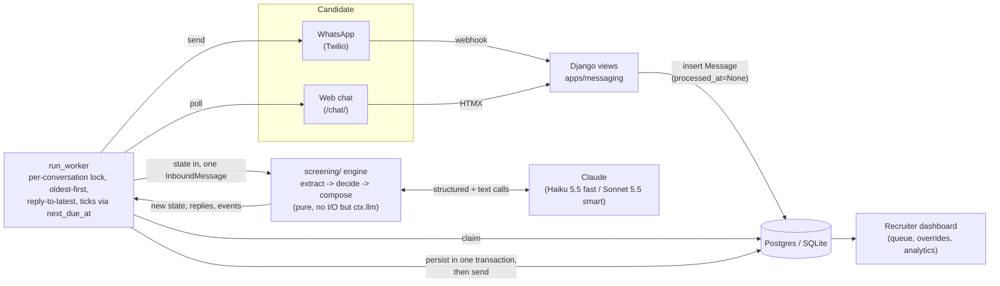

# Grupo Sazón Screening Agent

An AI agent that screens delivery-driver applicants for Grupo Sazón (fictional: 45 locations
in Spain and Mexico, ~1,000 applications/week) over WhatsApp and a web chat, so recruiters work
from a queue of pre-screened candidates instead of cold-calling everyone who applies. Built as
the take-home for Orbio's Forward Deployed Engineer role.

The full product spec lives in [`docs/process-design.md`](docs/process-design.md). This file is
about running and understanding the code.

## Status (2026-10-15)

**The whole thing works, end to end, for two different jobs.** What started as one hardcoded
driver role (CP1–CP3) was generalized into a config-driven field system (Phase 2, CP4): any job
picks required and preferred fields from a small typed catalog, a preferred field never
disqualifies but can break a tie between two otherwise-equal candidates. Both are live-verified,
not just unit-tested — see `docs/coordination/BOARD.md` for the checkpoint evidence.

| Lane | State |
| --- | --- |
| **Engine** (`screening/`) | Done. The full conversation engine for an arbitrary vacancy, 269 tests, live-verified on both shipped jobs. See `screening/README.md` for the current architecture. |
| **App** (Django) | Done — project, worker, both channels, dashboard, analytics, Docker, demo data for both jobs. |
| **Evals** (`evals/`) | Done — scenarios, simulator, scorers, a model-comparison report, a live run on the generalized engine, curated samples. |

**What's actually left:** an actual Railway deployment (L4) and the presentation notes (L6).
Everything else in the original task board is done — including the WhatsApp sandbox
investigation, which turned out not to be a code gap: real Twilio credentials, a working
tunnel, a webhook that correctly rejects unsigned requests, and Twilio's own message log
(checked directly via their API) all confirm the sandbox's "when a message comes in" webhook
simply can't be set on a free-tier account — it redirects straight to an upgrade page (D35).
The webhook's correctness rests on its tests, not a live demo, unless that account is upgraded.

## Architecture

Functional core, imperative shell: `screening/` is pure Python (state in, state + messages +
events out, no I/O except through an injected LLM client) and Django is the shell around it —
persistence, the two channels, the worker, and the recruiter dashboard. The same engine serves
the CLI and the evals runner.



Two rules shape everything else:

- **Code owns the process, the LLM owns the language.** State transitions, validation, knockouts
  and outcomes are deterministic code (`screening/policy.py`, `screening/validators/`). The LLM
  only extracts structured values from messy text and writes replies from a plan — it never
  decides eligibility. That makes every rejection auditable and immune to prompt injection.
- **One lock, one transaction per conversation turn.** The worker claims a conversation with
  `select_for_update(skip_locked=True)`, runs the engine, and persists state + outbound messages +
  events in one transaction before sending anything. That's the entire ordering and
  reply-to-latest guarantee — no separate queue.

**A third rule, added when the engine was generalized past one hardcoded job (Phase 2):**
which fields a screening asks, and whether each one *gates* or merely *ranks*, is a YAML config
per vacancy (`screening/config/vacancies/*.yaml`), not a code change — see
[`screening/README.md`](screening/README.md) for the field-type catalog and how to add a job. A
field marked `preferred` is asked once, never disqualifies, and only ever breaks a tie between
two candidates who are otherwise in the same outcome bucket (never a path around a real
requirement) — the concrete case is `kitchen_prep.yaml`, where a driver's license is a knockout
for the `driver` job but just a plus, worth 1.5 points, for a job that doesn't need one.

See `docs/coordination/DECISIONS.md` for the full, append-only decision log this summarizes, and
[`docs/code-tour.md`](docs/code-tour.md) for a line-by-line trace of one message through the
engine (written pre-Phase-2; still accurate in shape, see its note at the top).

## Setup

```bash
uv sync
cp .env.example .env            # then add a real ANTHROPIC_API_KEY
uv run python manage.py migrate
uv run python manage.py createsuperuser   # for /admin/; optional
uv run python manage.py runserver 8000    # in a second terminal: run_worker, below
```

`DEBUG=True` from `.env.example` is enough to run locally — SQLite, an auto-generated dev secret
key, no Twilio needed for the web chat.

## Running it

**CLI — talks to the real engine directly, the quickest way to see Alex actually work:**

```bash
uv run python -m screening.cli --country MX --lang es                      # interactive
uv run python -m screening.cli --country MX --script path/to/script.txt    # scripted
uv run python -m screening.cli --fake                                      # no API key, keyword stub
```

Prints every reply, the state diff and the events (including `llm_call` with tokens, cache hits
and latency) after each turn.

`--vacancy kitchen_prep` runs the other shipped job (no license requirement; one's preferred).

**Web chat — the full Django path (worker, persistence, polling), with the real engine:**

```bash
uv run python manage.py runserver 8000
uv run python manage.py run_worker          # second terminal; --once to drain and exit
```

Open `http://localhost:8000/chat/?vacancy=driver` (or `kitchen_prep`) — the `?vacancy=` param is
the production shape (one link per real job ad); the bare `/chat/` picker is a demo convenience.
Watch it land in `http://localhost:8000/dashboard/`.

**Recruiter dashboard:** `http://localhost:8000/dashboard/` (login required —
`uv run python manage.py seed_demo` creates a recruiter login and 24 real seeded screenings
across both jobs, or `createsuperuser` for a fresh one). Queue with status tabs and filters,
a detail page (fields in asking order, required then preferred, each preferred field showing its
weight and whether it scored), CSV export, and `/dashboard/analytics/` (funnel, outcomes, cost
and latency by purpose, a per-job breakdown).

**WhatsApp:** built and tested (`/webhooks/twilio/whatsapp/`, Twilio signature validation —
needs the real **Account SID + Auth Token**, `.env`'s `TWILIO_ACCOUNT_SID`/`TWILIO_AUTH_TOKEN`,
not a Twilio **API Key** which can send messages but can't sign incoming webhooks — and
idempotency on `MessageSid`). **Not live-demoable on a free Twilio account**: its WhatsApp
sandbox doesn't allow a custom webhook at all on that tier (confirmed directly via Twilio's
own API, D35) — this surfaced when testing it live, not something to work around here.
`/apply/` is the agent-initiated form (phonenumbers-parsed, E.164); candidates who message the
number first with no link or form screen for `WHATSAPP_VACANCY` (env, default `driver`).

**Tests:**

```bash
uv run pytest tests/engine tests/evals          # no Django at all, by design
DJANGO_SETTINGS_MODULE=config.settings uv run pytest tests/app
uv run ruff check .
```

**Evals:**

```bash
uv run python -m evals.run --suite smoke        # 5 scenarios, ~$0.10
uv run python -m evals.run                      # all 24 (both jobs), ~$0.17
uv run python -m evals.samples evals/runs/<dir>  # regenerate docs/sample-conversations/
```

24 ground-truth scenarios (`evals/scenarios/*.yaml`, 20 `driver` + 4 `kitchen_prep`, including a
tie-break pair that differs only in whether they have a license) run a Sonnet- or Haiku-played
persona against the real engine on a fake clock, score outcome/field/message-rule accuracy, and
report cost and latency. `evals/reports/` has the model-comparison and live-run reports;
`docs/sample-conversations/` has 6 curated, unedited transcripts — two deliberately show engine
stumbles that got fixed, not just the happy path.

## LLM choice and trade-offs

Claude behind a thin typed client (`screening/llm/`) — no LangChain/LangGraph/CrewAI, the
orchestration is a few hundred lines in `screening/engine.py` and `policy.py` that fit in a live
code review. Two tiers, chosen by evals, not by default (D12): **Haiku 5.5** for understanding
each message and writing each reply, **Sonnet 5.5** for the one-time recruiter summary.

**The comparison (V4, `evals/reports/model-comparison.md`), head to head on the same 20
scenarios, same simulated candidate:**

| Configuration | Scenarios passed | Fields correct | Cost / conversation | Cost at 1,000/week | Median latency |
| --- | --- | --- | --- | --- | --- |
| **Haiku fast + Sonnet summary (shipped)** | **20/20** | 100% | **$0.0059** | **$5.88** | 2.5 s |
| Sonnet fast + Sonnet summary | 18/20 | 99% | $0.0377 | $37.73 | 3.0 s |

Sonnet bought no measurable quality on anything scored — both got every outcome right — and cost
6.4× more. **Status: provisional**, one repeat per configuration instead of the planned three
(the Anthropic account ran out of credits mid-run); the direction is clear enough that the
decision shipped anyway, repeats pending if there's budget to confirm it further.

**Then the engine was generalized to any vacancy (Phase 2) and re-run live** on both shipped
jobs (`evals/reports/v8-v4-engine.md`, 24 scenarios): 20/24 passed, 96% outcome accuracy, 100%
knockout accuracy, 96% field accuracy, 100% message-rule and language-match compliance, $0.0062
per conversation, 2.3 s p50 per message. The 4 misses were simulator issues (an overly
improvisational persona, fixed on the evals side) and two real engine findings, both fixed and
re-verified live afterward (see D32–D34) — the report's failures are deliberately left visible
rather than quietly re-run clean, including in the curated samples (`docs/sample-conversations/`).

What makes this affordable at all: the system prompt (persona, rules, FAQ catalogue, the job's
own fields) is cached and byte-stable per vacancy — a live extract call reads ~5,000 of ~5,200
input tokens from cache. A deterministic guard (`screening/guard.py`) checks every composed
reply against the message rules and regenerates once, then trims, if it's broken — measured at
4 of 18 first drafts needing it, 0 of 18 final replies breaking a rule (D21).

**Note on recent runs:** while developing on a constrained budget (a 5 EUR top-up, meant to
stretch), `LLM_MODEL_SMART` was temporarily set to Haiku too, for both the engine's summary and
evals' simulator persona — so the V8 numbers above used Haiku throughout, not the shipped
Sonnet-summary configuration. The comparison table (V4) is the real one for the shipped config.

## Key engineering decisions

The full append-only log is `docs/coordination/DECISIONS.md` (34 entries and counting). The ones
most worth knowing:

- **Django over FastAPI, functional core / imperative shell** (D1, D2) — the engine is
  framework-free and unit-testable without a database; Django gives auth, admin and migrations
  for the shell, for free.
- **Code decides, the LLM speaks** (D3) — deterministic outcomes, auditable under GDPR Art. 22
  and the EU AI Act, immune to prompt injection by construction.
- **Vacancies: a config-driven field catalog, preference scoring that only ever breaks ties**
  (D25) — the field set, knockouts and ranking signals for a job are YAML, not code, but drawn
  from a small closed catalog an engineer reviews; a `preferred` field can never substitute for
  a failed `required` one, keeping D3's auditability argument intact even as the system got
  more flexible.
- **When code can know the answer, fix it in code, not the prompt** (D33) — a surname reply
  joining the stored first name, a read-back that can't misstate a flagged value, option labels
  in the candidate's own country vocabulary: each found live, each fixed where it can't drift
  with a model change, prompt fixes reserved for what only the model can judge.
- **Sequential per-conversation processing, reply only to the latest message** (D7) — a burst of
  messages never produces a stale question.
- **A DB-backed queue and a worker command, no Celery/Redis** (D8) — fewer moving parts at
  1,000/week; `select_for_update(skip_locked)` is enough. Revisit at 10K/week (see below).
- **SQLite tuned for the worker's long transaction** (D16) — `IMMEDIATE` + WAL, so a web insert
  waits instead of failing when the worker is mid-turn. Postgres in deploy needs none of this.
- **An engine or persist error consumes the message rather than retrying it** (D17) — a
  deterministic bug can't wedge a conversation or burn LLM calls forever; it shows up as a
  `worker_error` event on the dashboard instead.

## What's next

**To actually finish:** an actual Railway deployment (L4) and the presentation notes (L6). The
2 extra V4 repeats were deliberately skipped (not forgotten) — the decision they'd confirm is
already clear, and they'd cost most of the remaining demo budget to double-check it. Everything
else on the original board — engine, app, evals, both Phase 1 and the vacancy generalization,
and the WhatsApp investigation (D35) — is done, live-verified, or conclusively closed.

**Production, with more time:**
- **Voice:** same engine — it's channel-agnostic already (`Channel.WEB`/`WHATSAPP`/`SIM`) — with
  a speech-to-text/text-to-speech adapter and shorter, more fragmented turns.
- **ATS integration:** `screening.record.final_record(state)` is already the deterministic,
  typed JSON a client's ATS would consume; an outbound webhook or polling endpoint on status
  change is a small addition (sketch in `docs/ats-integration.md` if time allows — see BOARD L7).
- **Scaling to 10K/week:** the DB-backed queue (D8) and the lock-held-across-the-LLM-call design
  (D15) are fine at today's scale but become the bottleneck first. The fix is a lease-based claim
  instead of holding the row lock, with the LLM call made outside the transaction — both already
  flagged as the revisit point in D8 and D15.

## Project layout

| Path | Owns |
| --- | --- |
| `screening/` | The engine: schemas, config (incl. `config/vacancies/*.yaml`), validators, field-type catalog, scoring, LLM client, policy/state machine, compose, CLI. Own guide: `screening/README.md`. |
| `apps/candidates`, `apps/messaging`, `apps/dashboard` | Django: models, worker, both channels, dashboard, analytics. |
| `config/`, `manage.py`, `templates/`, `static/` | Django project plumbing. |
| `evals/` | Scenarios (both jobs), simulator, scorers, model comparison, sample-conversation generator. |
| `docs/process-design.md` | The product spec, including "Vacancies and preference scoring". |
| `docs/code-tour.md` | A traced, line-level walkthrough of one message through the engine (pre-Phase-2 shapes; still accurate in mechanics). |
| `docs/sample-conversations/` | 6 curated, real transcripts — includes engine stumbles, not just the happy path. |
| `docs/presentation-notes.md` | Demo script, demo-day checklist, talking points, the 10K/week and "more time" answers. |
| `docs/deployment.md`, `docs/ats-integration.md` | A Railway deploy walkthrough and an ATS-integration sketch — bonus docs, written against what already exists rather than invented. |
| `docs/coordination/` | How this was built: `BOARD.md` (tasks), `CONTRACTS.md` (interfaces, v4.1), `DECISIONS.md` (the why, 34 entries), `status/` (lane logs). |
| `tests/engine`, `tests/app`, `tests/evals` | Tests, one tree per lane. |
