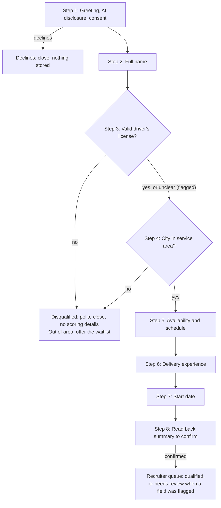

# Grupo Sazón Screening Agent: Process Design

October 2026 · Vlad

## Context and goals

The agent screens every Grupo Sazón applicant over WhatsApp minutes after they apply, so recruiters spend their time only on candidates who pass.

Today 13 recruiters make about 975 calls a week (15 a day each) for roughly 1,000 applications. With 60% of calls unanswered, only about 400 candidates a week are reached, and 80% of recruiter time goes to people who don't qualify.

The design targets both numbers:

- **Reach:** a message candidates answer when it suits them replaces a call they miss, and silent candidates get timed reminders.
- **Recruiter time:** knockout questions come first, code makes every eligibility decision, and recruiters work from a queue of pre-screened candidates with summaries.

We measure completion rate, drop-off by stage, median time to complete (design target: under 5 minutes) and time from application to recruiter contact. One engine serves both WhatsApp and a web chat used for testing.

## Conversation stages

The conversation runs in eight steps, with both knockout checks right after the name, so ineligible candidates finish within a few messages.

Any message can fill any field, so a candidate who answers several questions at once skips ahead. Corrections, job questions and silence are handled at every step (see Edge cases).

- The agent asks only for fields that are still missing, in the order shown.
- A failed knockout ends the conversation at once with the disqualified close.
- The read-back in step 8 lets the candidate fix any field before the outcome is set.

## Agent personality

The agent is Alex, Grupo Sazón's virtual hiring assistant: friendly, quick and upfront about being an AI.

- **Honest:** says it is an AI in the first message and whenever asked, and never claims to be a person.
- **Warm and practical:** sounds like a good shift manager, respects the candidate's time and avoids corporate language.
- **Local:** uses *tú* in Spanish and the country's own words: *carnet de conducir* and *coche* in Spain, *licencia de manejo* and *carro* in Mexico.
- **In its lane:** screens and answers job FAQs; pay negotiation, complaints and anything else go to a recruiter.
- **Never judgmental:** a disqualification is framed as a requirement of the role, not a verdict on the person.

## Data fields and validation

The agent collects seven fields, two of them knockouts; the model extracts values, but every rule below runs in code.

| Field | Stored as | Rule | If invalid or ambiguous |
| --- | --- | --- | --- |
| Full name | Text | First name plus at least one surname; no format policing | Ask once for the surname, then accept |
| Driver's license | Boolean (yes / no) | **Knockout:** no disqualifies. Anything unclear (expired, in progress, foreign) goes to review | Rephrase as yes/no; unclear goes to review |
| Country and city | Country and city from the service-area list | **Knockout:** must match a configured city; aliases and neighborhoods map to their city (CDMX, BCN, Gràcia) | Ambiguous: offer the closest 2–3 matches. Known city outside the list: disqualify. Unrecognized after 2 tries: review |
| Availability | List of full-time, part-time, weekends | At least one; combinations allowed | Re-ask with the options |
| Preferred schedule | List of morning, afternoon, evening, flexible | At least one; flexible stands alone | Re-ask with the options |
| Delivery experience | List of platform + years; empty means none | Years 0–40, months converted; platforms normalized (Glovo, Uber Eats, Just Eat, Rappi, DiDi Food, other) | No experience is valid, never a knockout |
| Start date | ISO date plus a pointer to the source message | Resolved against that message's timestamp, in the candidate's time zone; up to 6 months out | "ASAP" means today; vague answers get a request for a rough date |

Each record also stores language, country, channel ID, consent time, status, and the message each value came from. The final output is JSON validated against a typed schema.

## Edge cases

The agent never loops, never crashes and never invents an answer; anything it can't resolve goes to a recruiter.

| Case | Handling |
| --- | --- |
| Candidate goes silent mid-conversation | Reminders at 15 min, 2 h and 20 h, all inside WhatsApp's 24 h reply window, then marked abandoned (production adds an approved template message at 3 days). No messages 21:00–09:00 local time. State is saved, so a late reply resumes where it stopped |
| Invalid or ambiguous answer | Re-ask with options or an example, at most twice per field, then flag the field for review and move on |
| Several answers in one message, several messages in a row, or a later correction | Any message can fill or update any field; the agent acknowledges it and asks only for what's missing. Messages are processed one at a time in order, and only the latest gets a reply, so the agent never asks for something just answered |
| Language switch (Spanish ↔ English), including mixed messages | Reply in the language of the candidate's latest message; stored values are language-neutral |
| Question about the job (pay, hours, contract) | Answer only from the approved FAQ, then resume; if it isn't covered, say a recruiter will confirm |
| Voice note, image or sticker | Ask for a text reply |
| Off-topic, abusive or prompt-injection messages | One polite redirect, then close and flag. The model can't change outcomes, so injected instructions have no effect |
| Sensitive details volunteered (health, immigration) | Not added to the candidate record, and no follow-up questions |
| Asks to stop, or asks for a human | Stop: confirm, record the opt-out, send nothing more. Human: hand off to the recruiter queue |
| Applies twice from the same phone | Resume the existing conversation instead of starting over |
| Model or channel failure | Retry with backoff, then send a short holding message; conversation state is never lost |

## Outcomes

Code, not the model, sets one of four outcomes, and a recruiter can override any of them.

| Outcome | Trigger | Candidate hears | Recruiter sees |
| --- | --- | --- | --- |
| Qualified | License yes, city in area, summary confirmed | Thanks, and that a recruiter will message them to arrange an interview | Top of the queue, with summary and full JSON |
| Needs review | Unclear license, a field unresolved after 2 tries, or a human requested | The same as qualified, so nothing implies rejection | In the queue, with flagged fields highlighted |
| Disqualified | License no, or a recognized city outside the service area | A polite close naming the requirement; out-of-area candidates can join a waitlist | In a separate list with the reason; reversible |
| Abandoned or opted out | No reply after the final reminder, or asked to stop | Nothing further (an opt-out is confirmed once) | In analytics, with the stage where they dropped |

GDPR Article 22 and the EU AI Act both scrutinize automated hiring decisions, so every rejection is logged with its reason and can be reversed by a recruiter.

## Tone and length

Messages read like a quick WhatsApp from a friendly recruiter: short, with one question at a time.

- At most two short sentences, about 300 characters, and one question per message. The opening message is the only exception, because it carries the AI disclosure and the privacy link.
- Acknowledge each answer in a few words before the next question.
- Offer the options when the answer is a choice.
- Plain text with no formatting, and at most one emoji where it feels natural.
- Match the candidate's language and register, with no jargon such as "onboarding" or "ATS".

Example in Spain:

> **Alex:** ¡Hola! Soy Alex, el asistente virtual (IA) de Grupo Sazón 👋 Son 7 preguntas rápidas sobre el puesto de repartidor, unos 3 minutos. Tus datos solo se usan para esta candidatura: \[privacidad\]. ¿Empezamos?
>
> **Candidate:** sí, soy Laura Pérez y tengo carnet de coche
>
> **Alex:** ¡Genial, Laura! ¿En qué ciudad y barrio vives?

## Assumptions and open questions

These assumptions fill gaps in the brief, and each would be confirmed with Grupo Sazón in the first week of the engagement.

- The service area is a configured list of countries and cities covering the 45 locations; the demo uses sample data.
- Candidates either start the chat from a job-ad link or apply through a form, after which the agent sends the first message.
- Any valid driver's license qualifies, and unclear cases go to review rather than rejection.
- Start dates beyond 6 months are out of scope.
- Pay, contract and shift answers in the FAQ are placeholders until the client supplies them.

Questions for the client:

- [ ] Should the agent check minimum age, right to work or vehicle ownership?
- [ ] Do bicycle and e-bike riders, who need no license, count?
- [ ] Which recruiter or hub owns each city, for routing qualified candidates?
- [ ] How long should data from disqualified and abandoned candidates be kept?
- [ ] Can disqualified candidates reapply, and after how long?
